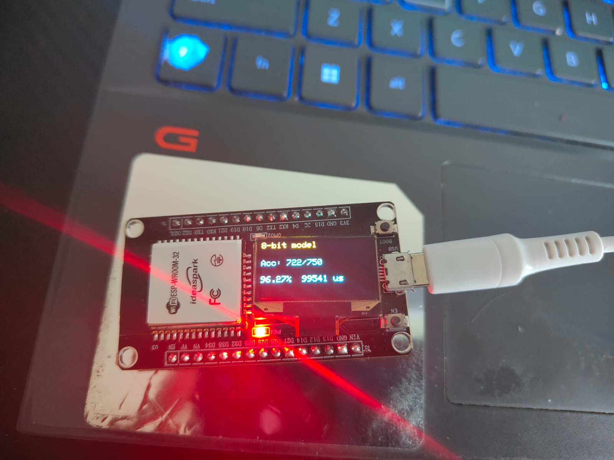
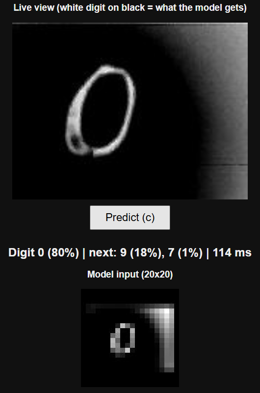
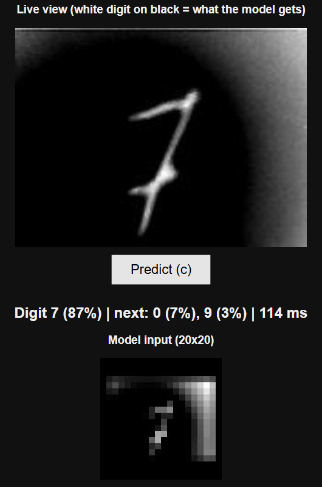
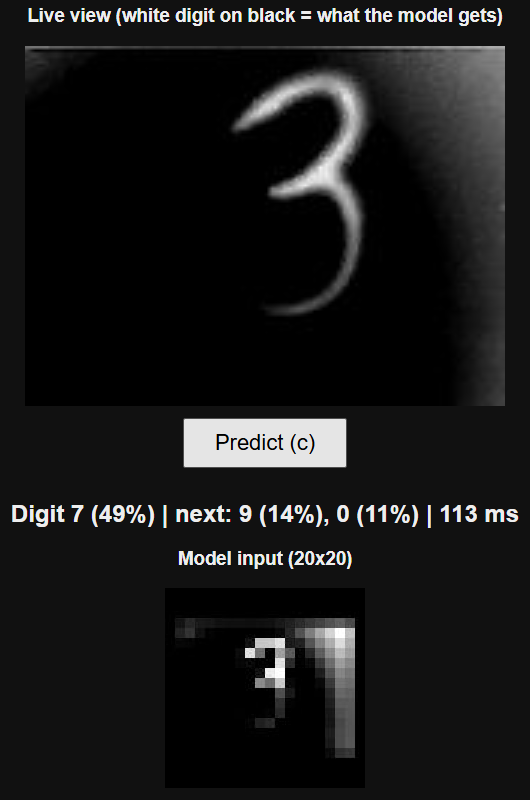
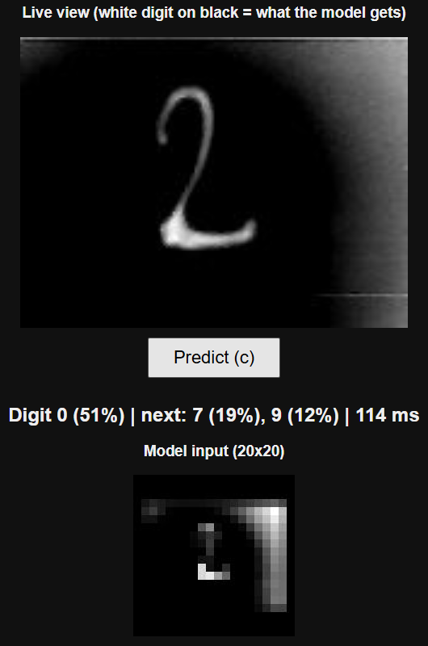
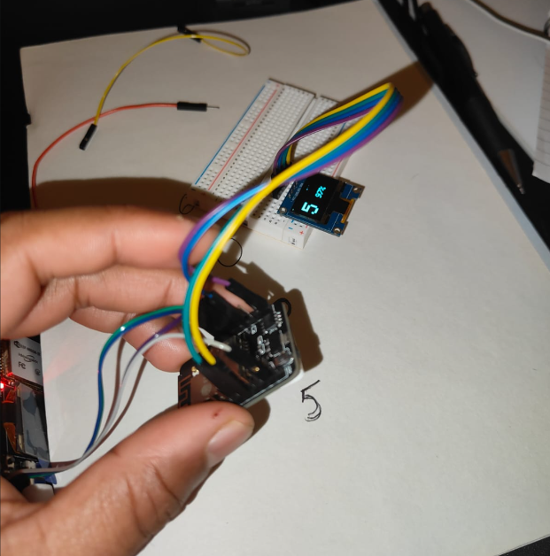

# Digit Recognition with TinyML on ESP32
 
A small CNN that recognises handwritten digits (0–9), quantized to int8, float16 and running on a plain ESP32-WROOM-32. Predictions and results are shown on an onboard OLED screen.
 
## Project Goal

- Train a small digit classifier on 20×20 grayscale images using deep neural netweork and CNN.
- Compare their accuracy and space to choose which model be fit for esp32
- Shrink it enough to fit and run on an ESP32.
- Measure what the shrinking costs: **space saved vs accuracy lost**.

## Extended Goal 
- Use the deployed model to test the real raw data captured from esp32 camera 
---
 
## Hardware Required
 
| Part | Note |
|---|---|
| ESP32-WROOM-32 dev board (oled onboard) | 4 MB flash, no PSRAM needed |
| SSD1306 OLED, 128×64, I²C | address `0x3C` |
| Jumper wires + USB cable | |
 
 
## Software Tools Used
 
- **Python 3**, Jupyter Notebook
- **TensorFlow / Keras**: training and TFLite conversion
- **scikit-learn, NumPy, SciPy, Matplotlib**: data split, metrics, plots
- **VS Code + PlatformIO**: firmware build and upload
- **TensorFlowLite_ESP32** `1.0.0`: TensorFlow Lite Micro for ESP32
- **Adafruit SSD1306 + GFX**: OLED driver
---
 
## Setup
 
**Python side**
```bash
python -m venv .venv
.venv\Scripts\activate          
pip install tensorflow scikit-learn numpy scipy matplotlib jupyter
```
 
**Firmware side:** install the PlatformIO extension in VS Code. Libraries are pulled automatically from `platformio.ini`:
 
```ini
[env:esp32dev]
platform = espressif32 @ 6.9.0
board = esp32dev
framework = arduino
monitor_speed = 115200
upload_speed = 921600
monitor_filters = esp32_exception_decoder
board_build.partitions = huge_app.csv
lib_deps =
  tanakamasayuki/TensorFlowLite_ESP32 @ 1.0.0
  adafruit/Adafruit SSD1306 @ ^2.5.10
  adafruit/Adafruit GFX Library @ ^1.11.9
```
 
`huge_app.csv` matters here: the 750 test images take about 1.2 MB of flash, which doesn't fit in the default app partition.
 
---
 
## Clone and Run
 
```bash
git clone https://github.com/<your-username>/<repo-name>.git
cd <repo-name>
```
 
1. Open `train.ipynb` and run all cells. It trains the models, converts them to TFLite, and writes the following into `firmware/src/`:
   - `model_data_8.h`: the int8 model as a C array
   - `model_data_16.h`: the float16 model as a C array
   - `test_data.h`: the 750 test images and their labels
2. Open the `firmware/` folder in PlatformIO.
3. Build, upload and open the Serial Monitor.
The board runs all 750 test images once, then prints the accuracy and inference time on Serial and the OLED.
 
---
 
## Approach
 
1. **Data**: 5000 digit images (20×20, from a `.mat` file). They're reshaped with `order='F'` because MATLAB stores data column by column, then split into train/val/test (3612 / 638 / 750), stratified.
2. **Model choice**: an MLP baseline vs a small CNN.
   - MLP: 52.6k params, 94.1% test accuracy, and it overfits.
   - CNN: 14.4k params, 97.2% test accuracy. It's smaller *and* better, so I chose the CNN. Light augmentation (rotation, shift, zoom) is added for robustness.
3. **Quantization**: two post-training versions.
   - **float16**: weights stored as 16-bit.
   - **int8**: full integer, calibrated on 300 representative training images.
   - Input and output are kept as **float32**, so the board just feeds raw pixels and reads probabilities, with no scale or zero-point handling.
4. **Export**: the model and test data are written as `const` C arrays with `alignas(16)`, so they stay in flash instead of being copied into RAM.
5. **On-device test**: TFLite Micro with a 60 KB tensor arena. Each image is copied into the input tensor, run with `Invoke()` and timed, and the argmax is compared with the true label.
---
 
## Conclusion
 
| Model | Runs on | Size | Accuracy (750 test images) |
|---|---|---|---|
| Keras CNN, float32 (baseline) | Laptop | 56.3 KB (params) | **97.20%** (729/750) |
| TFLite float16 | Laptop | 33.8 KB | 96.93% |
| TFLite int8 | Laptop | 21.0 KB | 96.67% |
| **TFLite int8** | **ESP32** | **21.0 KB** | **96.27%** (722/750) |
 
| What it cost | Result |
|---|---|
| Model size, baseline → int8 | 56.3 KB → 21.0 KB (**~63% smaller**) |
| Accuracy, baseline → ESP32 | 97.20% → 96.27% (**−0.93 pts**) |
| Saved `.keras` file → `.tflite` int8 | 207.7 KB → 21.0 KB (~10× smaller) |
| Avg inference time: | 99541 us
| Total inference time: | 74656 ms
 
<p align="center">
  <br>
  <em>ESP-WROOM-32 showing the final int8 accuracy (722/750)</em>
</p>
 
**Bottom line:** int8 gives a ~63% smaller model for under 1 point of accuracy, and it runs comfortably on a plain ESP32. I didn't tested float16 as it was not worthy for this project, but it's there under `firmware/src/model_data_16.h`
 
---
 
##  Digit Recognition with ESP32-Camera Live prediction and Future Upgradation 
- Initial idea was to use esp32 camera and live detect the handwritten digit all in esp32 
- During the rough test, I experience lots of inaccuracy as shown in the figure below. 
- Possible Reasons: 
    - Training Data is different from the real one 
    - Test Data format = Has black background but real data can have any type of background. I used white background and black handwritten digit , after captured the frame swapped 
<table>
  <tr>
    <td align="center"><br><em>0 → 0 ✅ (80%)</em></td>
    <td align="center"><br><em>7 → 7 ✅ (87%)</em></td>
  </tr>
  <tr>
    <td align="center"><br><em>3 → 7 ❌ (49%)</em></td>
    <td align="center"><br><em>2 → 0 ❌ (51%)</em></td>
  </tr>
</table>
<p align="center">
  <em>Live camera test on ESP32-CAM (~114 ms per prediction). The bright edge and the small, digit in the 20×20 input, most of the wrong predictions.</em>
</p>

<p align="center">
  <br>
  <em>ESP32-CAM setup</em>
</p>

## Lessons Learnt
 
- Tesorflow lite / TinyMl
- CNN Model Flow: conv2d, maxpool, dense and softmax
- MLP Vs CNN
- Inference Technique and Implimentation 

## References
1. CNN : https://www.youtube.com/watch?v=zfiSAzpy9NM
2. CNN Code using tf: https://www.youtube.com/watch?v=WvoLTXIjBYU
3. Inference TensorflowLite : https://www.youtube.com/watch?v=OJnaBhCixng
4. TinyML Deployment (Export model): https://www.hackster.io/news/easy-tinyml-on-esp32-and-arduino-a9dbc509f26c
5. Tinymlgen github : https://github.com/eloquentarduino/tinymlgen

## Use of AI 
1. To understand Tensorflow,Tensorflow-lite, how memory managed in microcontroller 
2. Export quantized model and test data 
3. Program Flow brainstorm